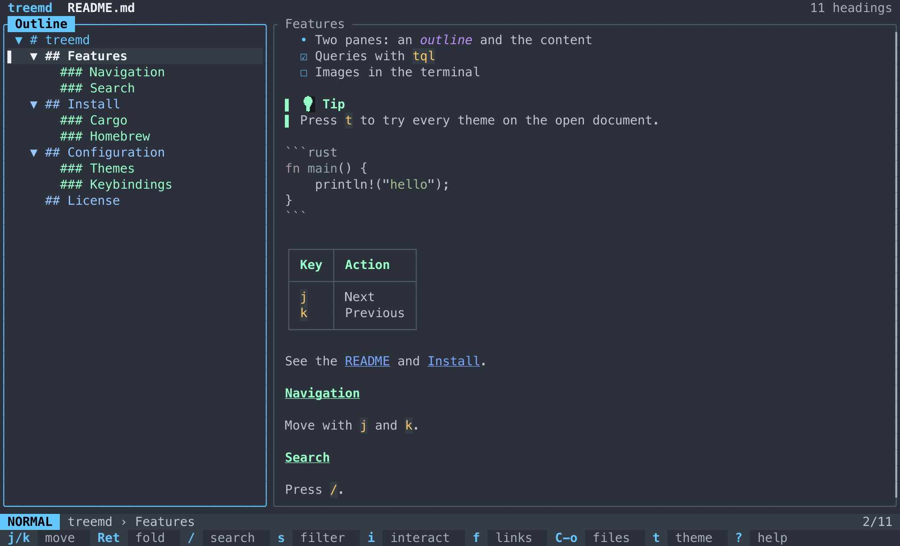
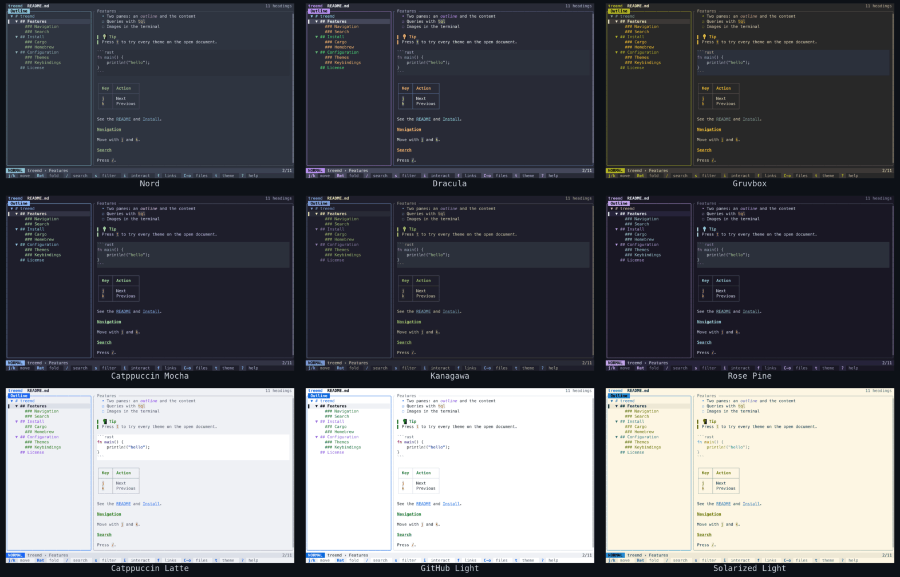

# treemd

[](https://crates.io/crates/treemd)
[](https://docs.rs/treemd)
[](https://opensource.org/licenses/MIT)
[](https://github.com/epistates/treemd/actions)

Read markdown by its structure. treemd shows a document's headings as a tree
you can fold and search, with the section you're on beside it, and gives the
shell the same view: list, extract and query any part of a document with a
[jq](https://jqlang.github.io/jq/)-like language.



- **Outline navigation**: fold, filter and jump between headings; the content follows.
- **Rich rendering**: syntax highlighting for 50+ languages, tables, task lists, callouts, images and Mermaid diagrams in terminals that support them.
- **Interactive mode**: toggle checkboxes, edit table cells, follow links and copy any element, writing changes back to the file.
- **Seventeen themes**, light ones included, each held to WCAG contrast, plus a no-color mode.
- **A CLI for scripts and agents**: heading lists with line ranges, section extraction, JSON output and a query language.
- **Remote documents**: `treemd github:owner/repo` or any markdown URL.

## Contents

- [Install](#install)
- [Quick start](#quick-start)
- [The TUI](#the-tui)
- [Themes](#themes)
- [The CLI](#the-cli)
- [Queries](#queries)
- [Remote and piped documents](#remote-and-piped-documents)
- [Configuration](#configuration)
- [Release binaries](#release-binaries)
- [Contributing](#contributing)

## Install

```bash
cargo install treemd       # crates.io
brew install treemd        # Homebrew, macOS and Linux
pacman -S treemd           # Arch Linux (extra)
pkgin install treemd       # NetBSD
```

Prebuilt binaries for Linux, macOS and Windows are on the
[releases page](https://github.com/epistates/treemd/releases); see
[Release binaries](#release-binaries) for verifying them. To build from source:

```bash
git clone https://github.com/epistates/treemd
cd treemd
cargo install --path . --locked
```

Shell completions, which offer only markdown files and directories:

```sh
treemd --setup-completions   # bash, zsh or fish, set up interactively
treemd --man-page > treemd.1 # the man page, for packagers
```

## Quick start

```sh
treemd README.md              # open a file
treemd .                      # pick a file in this directory
treemd github:rust-lang/rust  # a GitHub repo's README, whatever it's named
treemd -l -n README.md        # list headings with their line ranges
treemd -s Install README.md   # print one section
treemd -q '.code[rust]' doc.md # every Rust code block
```

In the TUI, the footer shows the keys for whatever you're doing, `?` lists
them all, and `:` opens a command palette that finds any command by name.

## The TUI

The outline is on the left and the selected section on the right. `Tab`
switches between them. Move through the outline with `j`/`k` and fold with
`Enter`, or hide it with `w` and read the content alone.

`/` searches the current section and `s` filters the outline. `f` lists the
section's links and follows one by number. `i` steps through the section's
elements one at a time: checkboxes, tables, links, code blocks, images and
`<details>`. In interactive mode, `Enter` uses the element, `y` copies it and
`e` opens your editor at its line. Table cells are edited in place, and every
change is written back to the file. `Ctrl+z` undoes the last edit.

### Keys

Every key can be remapped, see [Keybindings](#keybindings).

<details>
<summary><strong>Moving around</strong></summary>

| Key | Action |
|-----|--------|
| `j` / `k`, `↓` / `↑` | Next / previous heading |
| `g` / `G`, `Home` / `End` | First / last heading |
| `p` | Parent heading |
| `d` / `u`, `Ctrl+d` / `Ctrl+u`, `Ctrl+f` / `Ctrl+b`, `PageDown` / `PageUp` | Page down / up |
| `Ctrl+e` / `Ctrl+y` | Scroll the content a line |
| `Tab` / `Shift+Tab` | Switch pane |
| `5j`, `3k` | Repeat a move: digits start a count |
| `m` / `'` | Set the bookmark / jump to it |

</details>

<details>
<summary><strong>Outline</strong></summary>

| Key | Action |
|-----|--------|
| `Enter` / `Space` | Fold or unfold |
| `h` / `l`, `←` / `→` | Fold (or go to the parent) / unfold |
| `w` | Hide or show the outline |
| `[` / `]` | Outline width: 20%, 30% or 40% |
| `#` | Show or hide the `#` level markers |
| `T` | Only headings with open todos (`Esc` clears it) |

</details>

<details>
<summary><strong>Search</strong></summary>

| Key | Action |
|-----|--------|
| `/` | Search the current section |
| `s` | Filter the outline |
| `Tab` | While typing, switch between the two |
| `Enter` | Keep the search and read with the matches highlighted |
| `n` / `N` | Next / previous match |
| `Esc` | Clear the search |

</details>

<details>
<summary><strong>Links and files</strong></summary>

| Key | Action |
|-----|--------|
| `f` | List the section's links |
| `j` / `k`, `Tab` / `Shift+Tab` | Next / previous link |
| `1`-`9` | Link by number |
| `Enter` | Follow it |
| `/` | Search the links |
| `p` | The parent section's links |
| `b` / `Backspace`, `F` | Back / forward through followed links and files |
| `o` / `Ctrl+o` | Open a file |

In the file picker, `/` searches, `Backspace` goes up a directory and `h`
shows hidden files.

</details>

<details>
<summary><strong>Interactive mode and tables</strong></summary>

| Key | Action |
|-----|--------|
| `i` | Enter or leave interactive mode |
| `j` / `k` | Next / previous element |
| `Tab` / `Shift+Tab` | Next / previous link inside the element |
| `Enter` / `Space` | Use it: toggle, expand, follow, edit or view full screen |
| `y` | Copy it: the code, the link target, the table or the image source |
| `e` | Open the editor at its line |
| `Ctrl+z` | Undo the last edit |

On a table, `Enter` moves into its cells:

| Key | Action |
|-----|--------|
| `h` / `j` / `k` / `l` | Move between cells |
| `Enter` | Edit the cell |
| `y` / `Y` / `r` | Copy the cell / the row / the table as markdown |
| `Esc` | Back to the elements |

In the full-screen image viewer, `Space` plays or pauses a GIF and `h` / `l`
step through its frames.

</details>

<details>
<summary><strong>View, clipboard and the rest</strong></summary>

| Key | Action |
|-----|--------|
| `:` | Command palette |
| `t` | Choose a theme, previewed live |
| `r` | Show the markdown source |
| `M` | Release the mouse, so it selects text |
| `e` | Open the file in `$VISUAL` or `$EDITOR` |
| `y` / `Y` | Copy the section / a link to its heading |
| `Ctrl+l` | Redraw |
| `Ctrl+z` | Suspend to the shell (`fg` returns) |
| `?` | Help |
| `q` / `Ctrl+c` | Quit, asking first if there are unsaved edits |

`Esc` backs out of a search or mode. In help and the pickers, `q` closes them
instead of quitting.

</details>

### The mouse

The wheel scrolls the pane under the pointer. Clicking a heading selects it, a
second click folds or unfolds it, and clicking the content focuses it.

Because treemd captures the mouse for this, your terminal's own click-and-drag
selection needs a modifier: most terminals (iTerm2, kitty, GNOME Terminal,
Konsole, Windows Terminal) select natively while `Shift` is held. Or press `M`
to release the mouse entirely, and again to take it back. To copy a whole
section, `y` is quicker.

### Images

Images render with the terminal's graphics protocol (kitty, iTerm2 or Sixel),
and as half blocks where there isn't one. `Enter` on one in interactive mode
shows it full screen, and animated GIFs play. On Linux and macOS, Mermaid
diagrams render as images too. `--no-images` or `images.enabled = false` turns
images off.

## Themes



Press `t` to preview every theme on the open document; `Enter` keeps one. Or
set one by name in the config or with `--theme`:

| Dark | Light | Other |
|------|-------|-------|
| `OceanDark` (default), `Nord`, `Dracula`, `Solarized`, `Monokai`, `Gruvbox`, `TokyoNight`, `CatppuccinMocha`, `OneDark`, `RosePine`, `Kanagawa`, `Everforest`, `GitHubDark` | `CatppuccinLatte`, `SolarizedLight`, `GitHubLight` | `Terminal`: your terminal's own background and 16 colors |

Every theme's text meets WCAG contrast against what it's drawn on, in 24-bit
color and in 256-color terminals, which treemd detects. Code blocks follow the
theme unless `code_theme` names one.

With [`NO_COLOR`](https://no-color.org) set, or `--color-mode none`, treemd
draws without color: the selection, chips and current match in reverse video,
other matches underlined.

Any color can be overridden, see [Custom colors](#custom-colors).

## The CLI

Any of these flags prints and exits instead of opening the TUI:

```bash
treemd -l README.md                 # every heading
treemd -l --filter usage README.md  # headings containing "usage", any case
treemd -l -L 2 README.md            # only ## headings
treemd --tree README.md             # the headings as a tree
treemd -l -n README.md              # each with its [start-end] line range
treemd -s "Installation" README.md  # one section, heading included
treemd --at-line 120 README.md      # the heading that line 120 is under
treemd --count README.md            # headings per level
treemd -l -o json README.md         # the whole document as JSON
```

`-s` takes a heading's full text, in any case. The line ranges from `-n` make
treemd a good first step for an LLM or a script reading a large file: list the
headings, then read only the lines of the section that matters.

For AI coding agents, [`skills/treemd`](skills/treemd/SKILL.md) is a ready-made
skill that teaches an agent to survey a document with treemd before reading it.

## Queries

`-q` runs a query in a [jq](https://jqlang.github.io/jq/)-like language over
the document's elements. [docs/QUERY_LANGUAGE.md](docs/QUERY_LANGUAGE.md) is
the full reference, and `treemd --query-help` the short one.

```bash
treemd -q '.h2' doc.md                          # every level-2 heading
treemd -q '.h2[Install]' doc.md                 # whose text contains "Install"
treemd -q '.h2["Installation"]' doc.md          # whose whole text is "Installation"
treemd -q '.h2[-1]' doc.md                      # the last one
treemd -q '.code[rust]' doc.md                  # Rust code blocks
treemd -q '.h2[Install] | .code' doc.md         # code inside one section
treemd -q '.h1 > .h2' doc.md                    # direct children
treemd -q '.link | url' doc.md                  # every link target
treemd -q '.h | select(contains("API")) | text' doc.md
treemd -q '. | stats' doc.md                    # counts of everything
```

Selectors are `.h`, `.h1` to `.h6`, `.code`, `.link`, `.img`, `.table`,
`.list`, `.blockquote` and more. Functions like `count`, `first`, `sort_by` and
`join` see everything a selector returns at once, and a selector piped from a
heading looks only inside that heading's section.

`--query-output` picks `plain` (the default), `json`, `json-pretty`, `jsonl`,
`md` or `tree`. The JSON formats always print an array, `[]` when nothing
matches.

A query that matches nothing exits 0, as in jq; add `-e` to exit 1 instead. A
query that doesn't parse exits 3, and one that fails while running, such as
`"a" - 1`, exits 5.

## Remote and piped documents

```sh
treemd https://example.com/guide.md   # any markdown URL
treemd github:owner/repo              # a repository's README
curl -s https://example.com/doc.md | treemd -q '.h2'
cat notes.md | treemd                 # the TUI reads a pipe too
```

A piped document could come from anywhere, so its links and images stay inside
the working directory, and it loads no image by absolute path. A document opened
by URL reaches nothing on this machine at all. To treat piped documents like
local files:

```toml
[security]
trust_piped_documents = true
```

## Configuration

treemd reads a TOML file, and writes it when you change the theme or the outline
width in the TUI, keeping your comments:

| Platform | Location |
|----------|----------|
| Linux | `~/.config/treemd/config.toml` |
| macOS | `~/.config/treemd/config.toml` if it exists, otherwise `~/Library/Application Support/treemd/config.toml` |
| Windows | `%APPDATA%\treemd\config.toml` |

Every setting, with its default:

```toml
[ui]
theme = "OceanDark"             # see Themes
code_theme = "auto"             # follows the theme; or a syntect theme name
outline_width = 30              # 20, 30 or 40
outline_heading_markers = true  # the # markers in the outline
tree_style = "compact"          # "compact" or "spaced", for --tree

[terminal]
color_mode = "auto"             # "auto", "rgb", "256" or "none"

[content]
hide_frontmatter = true         # hide YAML frontmatter
hide_latex = true               # hide $...$, $$...$$ and \begin{...}
latex_aggressive = false        # also drop every line starting with \
code_fences = "full"            # "full", "label" or "none"
slug_style = "treemd"           # "treemd" or "github"

[images]
enabled = true

[editor]
editor = "nvim"                 # instead of $VISUAL / $EDITOR

[security]
trust_piped_documents = false
```

A keybinding that names an unknown key, action or mode is skipped and reported in
the status bar; the rest of the file still applies.

To override any of these for one run:

```bash
treemd --theme Dracula README.md
treemd --color-mode 256 README.md
treemd --no-images README.md
```

### Code blocks

`code_fences` sets how a fenced block is marked: `full` shows both fence rows as
written, `label` a dim language name above the block, and `none` nothing. The
rows are removed, not blanked, so they take no space.

The block background comes from the code theme, so it agrees with the syntax
colors. To set your own or turn it off:

```toml
[theme]
code_block_bg = { rgb = [40, 40, 50] }
# code_block_bg = "none"
```

`code_theme` takes `auto` or a built-in syntect theme: `base16-ocean.dark`,
`base16-ocean.light`, `base16-eighties.dark`, `base16-mocha.dark`,
`InspiredGitHub`, `Solarized (dark)` or `Solarized (light)`. For any other, put
its `.tmTheme` file in a `code-themes` directory next to `config.toml` and use
the file name without the extension.

### Heading anchors

`slug_style` decides how a heading becomes an anchor: the one `Y` copies, the
`id` and `slug` in `-l -o json`, and `.slug` and `slugify` in queries. `treemd`,
the default, drops `_` and gives repeated headings the same anchor. `github`
makes them the way github.com does: `snake_case` keeps its `_`, and the second
`## Setup` is `#setup-1`. Following a link finds the heading by either kind of
anchor.

### Custom colors

Override any color of the theme you're using. A color is a name (`"Cyan"`,
`"DarkGray"`), `{ rgb = [255, 128, 0] }`, or `{ indexed = 235 }` from the 256
palette.

```toml
[ui]
theme = "Nord"

[theme]
background = { rgb = [25, 25, 35] }
heading_1 = { rgb = [120, 200, 255] }
heading_2 = "LightBlue"
border_focused = "Cyan"
search_match_bg = { rgb = [100, 100, 50] }
```

<details>
<summary><strong>Every color field</strong></summary>

| Area | Fields |
|------|--------|
| Text | `background`, `foreground`, `bold_fg`, `italic_fg`, `list_bullet` |
| Headings | `heading_1` to `heading_5` |
| Borders and selection | `border_focused`, `border_unfocused`, `selection_bg`, `selection_fg`, `selection_indicator_fg`, `selection_indicator_bg`, `scrollbar_fg` |
| Bars | `title_bar_fg`, `status_bar_bg`, `status_bar_fg`, `footer_bg` |
| Code | `inline_code_fg`, `inline_code_bg`, `code_fence`, `code_block_bg` |
| Quotes and tables | `blockquote_border`, `blockquote_fg`, `table_border` |
| Links | `link_fg`, `link_selected_bg`, `link_selected_fg` |
| Search | `search_match_bg`, `search_match_fg`, `search_current_bg`, `search_current_fg` |
| Help and popups | `help_key_bg`, `help_key_fg`, `help_desc_fg` |

</details>

### Keybindings

Bind any key to any action, per mode. Sequences like `g g` work.

```toml
[keybindings.Normal]
"Ctrl+n" = "Next"
"Ctrl+p" = "Previous"
"g g" = "First"

[keybindings.Interactive]
"x" = "InteractiveActivate"

[keybindings.Search]
"Ctrl+n" = "NextMatch"
```

The modes are `Normal`, `Help`, `ThemePicker`, `Interactive`,
`InteractiveTable`, `LinkFollow`, `LinkSearch`, `Search`, `DocSearch`,
`CommandPalette`, `ConfirmDialog`, `CellEdit`, `FilePicker`, `FileSearch` and
`ImageViewer`. The defaults in
[`src/keybindings/defaults.rs`](src/keybindings/defaults.rs) name every action.

## Release binaries

| Platform | Archive |
|----------|---------|
| Linux x86_64 | `treemd-x86_64-unknown-linux-gnu.tar.gz` |
| Linux x86_64, static (musl, Alpine) | `treemd-x86_64-unknown-linux-musl.tar.gz` |
| Linux ARM64 | `treemd-aarch64-unknown-linux-gnu.tar.gz` |
| Linux ARM64, static (musl, Alpine) | `treemd-aarch64-unknown-linux-musl.tar.gz` |
| macOS x86_64 | `treemd-x86_64-apple-darwin.tar.gz` |
| macOS ARM64 (Apple Silicon) | `treemd-aarch64-apple-darwin.tar.gz` |
| Windows x86_64 | `treemd-x86_64-pc-windows-msvc.exe.zip` |

Each archive holds the binary and `LICENSE`, and the `.tar.gz` archives the man
page too. The glibc builds need glibc 2.28 or newer (RHEL 8, Debian 10, Ubuntu
18.10); the musl builds need no glibc. The macOS binaries are signed with a
Developer ID and notarized by Apple.

`SHA256SUMS` lists every archive's hash, and each archive has a signed build
provenance attestation showing it was built by this repository's release
workflow from the tagged commit:

```bash
sha256sum --check --ignore-missing SHA256SUMS
gh attestation verify treemd-x86_64-unknown-linux-gnu.tar.gz --repo Epistates/treemd
```

The archives are reproducible: the same binaries packaged by
[`scripts/package-release.sh`](scripts/package-release.sh) with the same tar,
gzip and zip give byte-identical archives.
[`.github/workflows/release.yml`](.github/workflows/release.yml) shows how each
target is built.

## Contributing

Issues and pull requests are welcome. The project uses
[just](https://github.com/casey/just) for its checks:

```bash
just gate        # format, lints, docs and every test: what CI runs
just deny        # licenses and advisories, with cargo-deny
just screenshots # every screen in every theme, as SVGs in target/screenshots
```

`just screenshots` is the quickest way to review a UI change across themes, a
narrow terminal and no-color mode. [CHANGELOG.md](CHANGELOG.md) has the history.

## Similar tools

- [`glow`](https://github.com/charmbracelet/glow): renders markdown beautifully, with a file browser
- [`mdcat`](https://github.com/swsnr/mdcat): prints rendered markdown to the terminal
- [`bat`](https://github.com/sharkdp/bat): a syntax-highlighting pager
- [`tree`](https://linux.die.net/man/1/tree): the directory listing whose shape the outline borrows

## License

[MIT](LICENSE)

[](https://ratatui.rs/)
